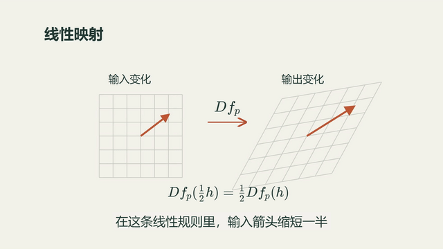
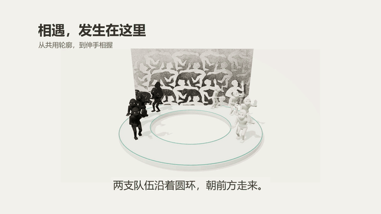
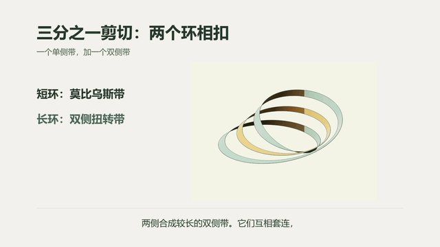
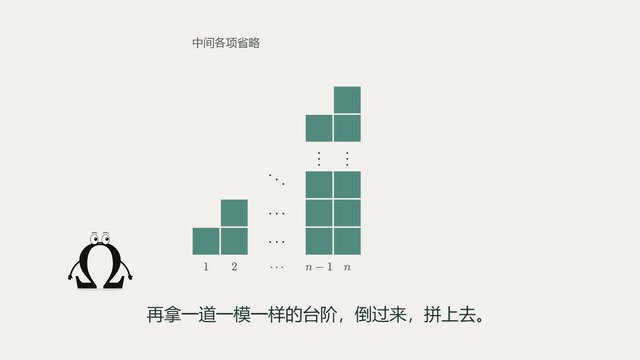
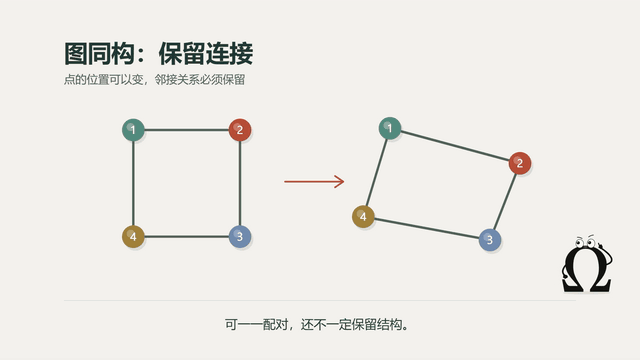
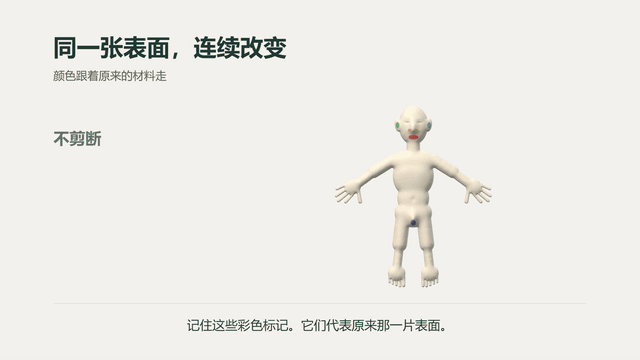
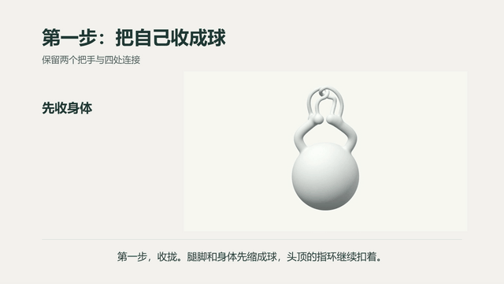

# 数语视频与动画

数学科普视频的制作仓库：研究好的视频，积累风格、角色和镜头，核对数学依据，再合成成片。开工可选 **讲解模式** 或 **无讲解模式（剧情动画）**。无讲解模式保留画外配音、字幕可选，以故事、动作和音效推进，角色参与故事而不面向观众讲课。Manim 按镜头需要选择。

首次使用看 [安装与命令](docs/SETUP.md)；制作前看 [能力选择](docs/PRODUCTION-OPTIONS.md) 和 [口播稿](docs/NARRATION.md)；引擎分工看 [架构](docs/ARCHITECTURE.md)，交付要求统一在 [验证](docs/VALIDATION.md#交付核对)。

```powershell
.\shuyu.ps1 start geometry-adventure --mode story-animation --title "几何奇遇"
```

命令创建本地简报与因果分镜模板，创作方法见 [无讲解剧情动画](writing/references/story-animation.md)。交互终端执行 `shuyu start <作品>` 可在开始时选择两种模式；原有作品继续按已确认的方式制作。

每部新制作或修改的影片固定交付 **视频 MP4 + 封面 JPG**。封面采用一个视觉主体、一句短钩子，随作品独立设计；已有成片可单独补图，无需重新渲染。

新作品的源文件和视频文件只留本地，Git 不再默认增加 MP4。首页 GIF 保持精选，不按作品数量持续追加。发布到平台使用 [publish 模块](publish/SKILL.md)：生成可复制的 B 站资料页，由用户手动上传、填写和发布。

## 作品预览

下方动图为 8 秒无声片段；点击预览图打开或下载完整成片，均为 1920×1080、30 fps，含中文配音和字幕。

| 作品 | 动画预览 · 点击查看完整 MP4 |
| --- | --- |
| **数学中的光滑，到底是什么意思？**<br>从导数到光滑结构，以四维球问题收尾<br>6 分 57 秒 · [封面：你好光滑](public/covers/smooth-structure-long-cover.jpg) | [](public/videos/smooth-structure-long.mp4?raw=true) |
| **画里的人，怎么走出来了？**<br>《遭遇》：图底关系、镶嵌与三维相遇<br>3 分 05 秒 | [](public/videos/escher-encounter-explainer.mp4?raw=true) |
| **莫比乌斯带**<br>反向接缝、剪切与相扣<br>2 分 48 秒 | [](public/videos/mobius-explainer.mp4?raw=true) |
| **台阶的一半**<br>一般项、省略号与翻转拼合<br>1 分钟 | [](public/videos/staircase-sum.mp4?raw=true) |
| **什么是相等**<br>从数值相等到结构相同<br>2 分 55 秒 | [](public/videos/equality-explainer.mp4?raw=true) |
| **人的表面，为什么能变成球面？**<br>理想外表面、同胚与亏格<br>2 分 35 秒 | [](public/videos/human-to-sphere-explainer.mp4?raw=true) |
| **手指相扣，能挣脱吗？**<br>橡胶人体模型与连续解环<br>2 分 34 秒 | [](public/videos/topology-unlock-explainer.mp4?raw=true) |

公开副本及更新说明见 [public/](public/README.md)。

## 目录

| 目录 | 作用 | 入口 |
| --- | --- | --- |
| [style/](style/README.md) | 数语暖白视觉风格：颜色、字体、各引擎的主题适配 | [风格页](style/preview.html) |
| [brand/](brand/README.md) | Ω 品牌片头：3 秒常用版、7 秒文字动画版 | [双版本预览](brand/preview.html) |
| [character/](character/README.md) | Ω 角色：表情、手势、15 个动作，可按时间取样、任意位置渲染 | [交互动作库](character/study.html) |
| [writing/](writing/SKILL.md) | 科普口播构思、改稿、文风反馈与配音输入导出 | [文件与命令](writing/references/files.md) · [候选改稿案例](examples/writing/EDITING.md) |
| [cover/](cover/SKILL.md) | 简洁封面设计、本地排版、手机图与视频/图片成对交付 | [配置与命令](cover/references/files.md) |
| [publish/](publish/SKILL.md) | B 站发布资料、文件一致性检查与本地复制页面 | [填写方式与字段](publish/references/bilibili.md) |
| `studies/`（本地） | 好视频的拆解：原片、字幕、抽帧、表达方法 | 本地 `studies/production-guide.md` |
| [math/](math/README.md) | Astra 数学讲解片段：简报 → 数学依据 → 分镜 → Manim → 审核 | `.\shuyu.ps1 math doctor` |
| [sound/](sound/README.md) | 配音、Freesound 音效选材与下载、混音和响度测量 | [音效 skill](sound/SKILL.md) |
| [motion/](motion/SKILL.md) | 动作设计、镜头与转场运行时、路径与连续性检查 | [台阶镜头验证](examples/staircase/README.md) |
| [public/](public/README.md) | 公开成片与 README 动图预览 | [作品预览](#作品预览) |
| `films/`（本地） | 作品源码与定稿输入，每部可独立重建 | [公开作品预览](#作品预览) |

[制作选项：模式 / Omega / Manim / 字幕](docs/PRODUCTION-OPTIONS.md) · [积累方向](docs/REPOSITORY.md) · [索引](catalog.json) · [公共素材与分镜验证](docs/VALIDATION.md)

`films/`、`studies/` 和 `output/` 只保存在本地，不进入 Git；`public/` 保留此前公开的成片和精选动图，后续默认不新增视频文件。其余本地作品与研究资料链接在远程仓库中不可用。全新克隆可先运行已纳入 Git 的 `examples/staircase` 验证环境。

## 统一工作区

模块提供能力，作品与示例组织内容，生成物集中到根目录。约定见 [技术架构](docs/ARCHITECTURE.md) 和 [安装说明](docs/SETUP.md)。

```text
workspace.json         项目、引擎版本与输出约定
requirements*.txt      Python 依赖，统一安装到 .venv
package*.json          Node 依赖，统一安装到 node_modules
style/fonts.json       字体来源；.cache/fonts 保存可复用子集
examples/              可重建验证示例：staircase、homeomorphism
films/                 实际作品源码和定稿输入
public/                公开成片副本与 README 动图
motion/ math/ …         公共能力源码、技能与说明
output/<项目>/          构建包、视频、报告和数学片段任务
```

```powershell
.\shuyu.ps1 setup --math --dev
.\shuyu.ps1 list
.\shuyu.ps1 prepare staircase-test
.\shuyu.ps1 check staircase-test
.\shuyu.ps1 render staircase-test
.\shuyu.ps1 math prepare --project <作品> --prompt-file <主题文件>
.\shuyu.ps1 test --math
```

台阶对比视频保存在本地 `output/staircase-test/comparison/`。历史影片的旧输出位置只保留指向根目录的兼容链接；新命令统一写入 `output/`。研究资料和版本化证据仍按出处归档。

## 参考与致谢

- [sound/](sound/README.md) 与 [motion/](motion/SKILL.md) 参考 [Vibe Motion（vibe-motion/skills）](https://github.com/vibe-motion/skills) 的音效与动作设计方法，并结合数语的制作流程修改、适配；动作模块的具体来源与改写范围见 [motion/SOURCE.md](motion/SOURCE.md)。
- [math/astra/](math/astra/) 基于 [Math-To-Manim（HarleyCoops/Math-To-Manim）](https://github.com/HarleyCoops/Math-To-Manim) 的 Astra 实现，适配数语的数学片段制作、渲染与审核流程；具体来源与改动见 [math/SOURCE.md](math/SOURCE.md)。
